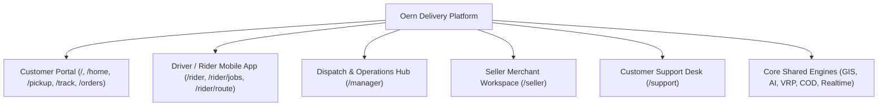

# Oern Application Features & Capabilities

This document provides a comprehensive inventory and functional explanation of all features, user interfaces, screens, and operational capabilities available in the **Oern Delivery Platform**.

---

## Quick Navigation

---

## 1. Customer Application Features

The customer application is the primary public entry point, built for mobile and desktop web browsers.

### 1.1 Welcome & Onboarding ([`/welcome`](file:///Users/happer/Projects/oern/src/app/welcome/page.tsx))
- **Brand Greeting & Interactive Mascot:** Features an animated mascot ([`CheetahRun`](file:///Users/happer/Projects/oern/src/components/delivery/cheetah-run.tsx)) introducing Oern's fast door-to-door delivery promise.
- **Guest Tracking Lookup:** Allows visitors to track any parcel immediately by entering a tracking code (e.g., `ORD-20261023-XXXX`) without creating an account.
- **Authentication Gateway:** Quick switches for signing in ([`/signin`](file:///Users/happer/Projects/oern/src/app/signin/page.tsx)) or signing up ([`/signup`](file:///Users/happer/Projects/oern/src/app/signup/page.tsx)).

### 1.2 Customer Home Dashboard ([`/home`](file:///Users/happer/Projects/oern/src/app/home/page.tsx))
- **Live In-Transit Delivery Banner:** Automatically surfaces the customer's next incoming parcel with live arrival countdown, driver name, vehicle badge, and a direct button to the live tracking map.
- **Quick Order Creation:** Primary call-to-action button to initiate a new door-to-door pickup.
- **Shipment Code Search Bar:** Instant search input that resolves tracking numbers directly.
- **Recent Orders List:** Displays recent shipments with stage pills (`Waiting`, `Assigned`, `Collected`, `On the way`, `Delivered`).
- **Persistent Bottom Navigation:** Direct one-tap navigation across Home, Orders, Pickup, Notifications, and Profile.

### 1.3 3-Step Pickup Request Flow ([`/pickup`](file:///Users/happer/Projects/oern/src/app/pickup/page.tsx))
A guided wizard allowing individuals and businesses to schedule a door pickup:
- **Step 1: Interactive Location Pinning ([`/pickup/map`](file:///Users/happer/Projects/oern/src/app/pickup/map/page.tsx)):**
  - Interactive map with GPS auto-locate to drop pickup and delivery pins.
  - Automatic reverse geocoding into formatted street addresses and Yangon townships.
- **Step 2: Parcel & Recipient Details ([`/pickup/details`](file:///Users/happer/Projects/oern/src/app/pickup/details/page.tsx)):**
  - Recipient full name and contact phone number.
  - Pickup contact name and phone (for office or third-party senders).
  - Parcel weight in kilograms and package description.
  - Optional special delivery instructions or door notes.
- **Step 3: Payment Method & Dynamic Pricing ([`/pickup/review`](file:///Users/happer/Projects/oern/src/app/pickup/review/page.tsx)):**
  - **Dynamic Fee Breakdown:** Transparently lists Base Delivery Fee, Distance Surcharge, Weight Surcharge, and COD Handling Fee.
  - **Payment Selection ([`PaymentMethodPicker`](file:///Users/happer/Projects/oern/src/components/delivery/payment-picker.tsx)):**
    - **CTZPay (Prepaid):** Prepay in-app so the driver does not collect cash at the drop-off.
    - **Cash on Delivery (COD):** Recipient pays cash upon delivery.
  - **"I'm away from home" Switch:** Automatically suggests digital prepayment when the sender is not physically present at the pickup location.
- **Atomic Order Submission:** Generates an official tracking code and places the shipment into the dispatch queue immediately.

### 1.4 Real-Time Parcel Tracking ([`/track`](file:///Users/happer/Projects/oern/src/app/track/page.tsx))
- **Interactive Mapbox Map:** High-resolution vector map featuring road routes, route polylines, pickup green pin, destination red pin, and live driver vehicle marker.
- **Real-Time GPS Marker Updates:** Subscribes to Supabase Realtime to animate the courier's vehicle icon smoothly as coordinates stream from the field.
- **Predictive Dynamic ETA:** Calculates minutes until delivery based on driver progress, vehicle speed, and active road delay reports.
- **Status Stepper Timeline:** 5-step visual indicator tracking `Assigned` → `Accepted` → `Collected` → `On the way` → `Delivered`.
- **Driver Profile Card:** Shows the assigned courier's name, vehicle license plate, vehicle classification, and a direct click-to-call phone button.
- **COD Payment Summary:** Clear receipt card showing cash due, payment status, and discrepancy notices.
- **Help & Support Escalation:** One-tap button opening an assistance sheet to report delays or communicate with customer care.

### 1.5 Orders & Delivery History ([`/orders`](file:///Users/happer/Projects/oern/src/app/orders/page.tsx))
- **Active Tab:** Lists all shipments currently in transit, out for delivery, or awaiting pickup.
- **History Tab:** Archives completed and closed deliveries with terminal status timestamps.
- **Search & Filter:** Filters deliveries by recipient name, tracking code, or destination township.

### 1.6 Customer Activity Timeline ([`/notifications`](file:///Users/happer/Projects/oern/src/app/notifications/page.tsx))
- Chronological timeline of parcel milestone events: assignment notifications, pickup confirmations, courier pre-arrival alerts, and completion receipts.

### 1.7 Customer Profile & External Tracking ([`/profile`](file:///Users/happer/Projects/oern/src/app/profile/page.tsx))
- Personal account details, phone number, and default delivery address.
- **External Multi-Provider Tracking:** Customers can link and track tracking codes from external logistics carriers (e.g., Royal Express, Ninja Van, DHL) in their Oern profile.

---

## 2. Driver & Rider Mobile Application Features

A dedicated mobile web interface ([`/rider`](file:///Users/happer/Projects/oern/src/app/rider/route/page.tsx)) built for motorcycle couriers and van drivers navigating on the road.

### 2.1 Township Job Board ([`/rider/jobs`](file:///Users/happer/Projects/oern/src/app/rider/jobs/page.tsx))
- **Township-Clustered Job Cards:** Open jobs bundled by delivery township (e.g., `Kamayut`, `Hlaing`, `Bahan`, `Mayangone`).
- **Pre-Claim Metrics:** Displays aggregate parcel count (up to 8 parcels), total weight (up to 150 kg), and total COD cash to be collected.
- **Priority Visual Badges:** Visual tags indicating `normal`, `high`, or `urgent` jobs.
- **One-Tap Job Claiming:** Atomic `Take Job` action that locks the batch, assigns child parcels to the courier, and materializes stops into the route manifest.

### 2.2 Active Multi-Stop Route Manifest ([`/rider/route`](file:///Users/happer/Projects/oern/src/app/rider/route/page.tsx))
- **Stop Sequencing:** Chronologically sequences pickups and drop-offs with address, recipient contact, and parcel checklist.
- **Active Stop Focus:** Highlights the current active stop with an enlarged action card and contact button.
- **Turn-by-Turn Navigation:** Tapping "Navigate" opens Google Maps with pre-filled destination coordinates.
- **Intelligent "Try Later" (Deferred Stop):** If a recipient is unavailable, the driver taps "Try Later". Rather than appending the stop to the end of the shift, the engine calculates the minimum detour and re-inserts the stop into the most efficient sequence.
- **Dispatcher Revisions Banner:** Instant alert notification if a manager adds an urgent pickup or reorders stops while the driver is on the road.

### 2.3 Parcel Pickup Confirmation
- At sender handoff, the driver marks the parcel `picked_up`.
- **Automatic GPS Watch Trigger:** Confirmation triggers browser `navigator.geolocation.watchPosition()`, sharing live location across all collected parcels simultaneously.

### 2.4 Parcel Handover & Proof of Delivery (POD) ([`rider-handover.tsx`](file:///Users/happer/Projects/oern/src/components/delivery/rider-handover.tsx))
- **Stop Checklist:** Checkbox verification for all parcels assigned to that drop-off stop.
- **Proof of Delivery (POD) Photo Capture:** In-app camera integration with HTML5 Canvas compression to resize and upload proof photos to Supabase Storage.
- **COD Collection Entry:** Input actual cash received from the customer; automatic discrepancy calculation if payment is short or over.
- **Discrepancy Logging:** Mandatory reason selection if cash collected does not equal expected COD.
- **Swipe-to-Confirm ([`SwipeConfirm`](file:///Users/happer/Projects/oern/src/components/delivery/swipe-confirm.tsx)):** Slider gesture preventing accidental stop closures.
- **Barcode Scan Sheet ([`scan-sheet.tsx`](file:///Users/happer/Projects/oern/src/components/delivery/scan-sheet.tsx)):** Simulated optical scanner for scanning parcel barcodes.

### 2.5 Road Incident & Hazard Reporting ([`rider-tools.tsx`](file:///Users/happer/Projects/oern/src/components/delivery/rider-tools.tsx))
- One-tap road hazard submission from the route screen.
- Categorized hazard logging: `Congestion`, `Closure`, `Roadwork`, `Flooding`, `Hazard`.
- Severity levels: `low`, `medium`, `high`, `blocked`.
- Automatic coordinate geotagging feeds the manager's flood watch and the dispatch routing engine.

### 2.6 Emergency Assistance & Energy SOS
- Quick-call assistance sheet for couriers facing field difficulties:
  - Low fuel / EV battery charging needed.
  - Vehicle breakdown or flat tire.
  - Road accident or damaged parcel.
- Broadcasts current vehicle battery/fuel level and exact GPS coordinates to dispatchers.

---

## 3. Manager & Dispatcher Command Center Features

A desktop operations hub ([`/manager`](file:///Users/happer/Projects/oern/src/app/manager/home/page.tsx)) for fleet managers, dispatchers, and operations staff.

### 3.1 Live Operations Dashboard ([`/manager/home`](file:///Users/happer/Projects/oern/src/app/manager/home/page.tsx))
- **Urgent Attention Exceptions Strip:** Highlights critical cases requiring dispatcher action:
  - Stale GPS pings (>15 min silence).
  - Open courier assistance requests.
  - High in-field cash liability.
  - Failed deliveries requiring resolution.
- **Real-Time Fleet GIS Map:** Live view of all active couriers, color-coded route lines, vehicle status, and parcel destination pins.
- **Hourly Dispatch Histogram:** 12-hour bar graph visualizing hourly order ingestion and completion velocity.
- **Key Operational Metrics:** Active fleet count, unassigned orders, deliveries completed today, and total COD collected.

### 3.2 Order Management & Intelligent Dispatch ([`/manager/order`](file:///Users/happer/Projects/oern/src/app/manager/order/page.tsx))
- **Unassigned Orders Queue:** Comprehensive table of all pending shipments with search and filtering by township, date, and weight.
- **AI Recommendation Engine ([`src/lib/delivery/intelligence.ts`](file:///Users/happer/Projects/oern/src/lib/delivery/intelligence.ts)):**
  - Scores candidate drivers based on proximity to pickup, current workload, and duty status.
  - Scores candidate vehicles based on cargo weight capacity and energy readiness.
  - Generates transparent, human-readable assignment rationale.
- **Atomic Assignment Action:** Prevents race conditions and locks the order in Supabase.
- **Manual Order Creator ([`/manager/order/create`](file:///Users/happer/Projects/oern/src/app/manager/order/create/page.tsx)):** Enables phone-in or walk-in order creation with interactive pickup/drop-off map pinning.

### 3.3 Automated Batching & Job Board Governance ([`/manager/jobs`](file:///Users/happer/Projects/oern/src/app/manager/jobs/page.tsx))
- **9-Hour Batch Scheduler Status:** Displays countdown to next scheduled cron batch.
- **"Run Auto-Accept & Batch" Action:** Automatically accepts pending orders and clusters them into township jobs (max 8 parcels, 150 kg).
- **"Reproduce Unclaimed Tasks" Action:** Extracts stagnant unclaimed jobs, escalates priority to `high` or `urgent`, extends delivery buffers by 90 minutes, and re-posts to the driver board.
- **Batch History & Audit Logs:** Itemizes past batch runs, trigger sources (`schedule`, `manual`, `automation`, `reproduce`), and job counts.

### 3.4 Vehicle Fleet & Energy Management ([`/manager/vehicles`](file:///Users/happer/Projects/oern/src/app/manager/vehicles/page.tsx))
- **Fleet Directory:** Tracks motorcycles, delivery vans, and electric trucks.
- **EV Battery & Fuel Gauges:** Real-time visual progress bars showing battery charge or fuel tank percentage.
- **Energy Readiness Evaluation:**
  - Compares vehicle usable range (after removing 15% safety reserve buffer) against assigned route distance.
  - Assigns readiness status: `sufficient`, `low`, `insufficient`, `unknown`.
- **Maintenance Schedules:** Logs odometer mileage, next service milestones, and maintenance history (oil change, tire replacement, battery service).
- **Delivery Cost Analytics:** Breakdown of operating expenditures (fuel, charging, tolls, maintenance, labor).

### 3.5 Cash on Delivery (COD) Reconciliation Ledger ([`/manager/cod`](file:///Users/happer/Projects/oern/src/app/manager/cod/page.tsx))
- **In-Field Cash Exposure:** Aggregates all unremitted cash currently held across couriers.
- **Per-Driver Liability Ledger:** Itemizes cash held by each courier with expected vs. collected totals.
- **Critical Discrepancy Exception Filter:** Highlights deliveries marked delivered with 0 MMK collected.
- **Remittance Settlement Modal:** Dispatchers audit physical cash presented by drivers against system records.
- **One-Click Remittance Settlement:** Stamped confirmation clearing driver cash liability.

### 3.6 Severe Weather & Flood Watch Monitor ([`manager-flood-watch.tsx`](file:///Users/happer/Projects/oern/src/components/delivery/manager-flood-watch.tsx))
- **GIS Flood Overlay:** Visualizes Yangon flood zones and water level gauges on the operations map.
- **Road Hazard Review Queue:** Managers inspect driver-submitted road notes and AI classification decisions.
- **Detour Activation:** Verifying an `avoid` road hazard injects detour waypoints into active courier routes.

### 3.7 Business Profile & Configuration ([`/manager/business`](file:///Users/happer/Projects/oern/src/app/manager/business/page.tsx))
- Operational parameters: Service area boundaries, operating hours, base delivery fees, and central depot coordinates.

---

## 4. Merchant Seller Portal Features ([`/seller`](file:///Users/happer/Projects/oern/src/app/seller/page.tsx))

A dedicated workspace for e-commerce vendors and retail stores shipping daily customer orders:
- **Commerce Channel Registration:** Connect storefronts and logistics carrier accounts (Shopify, WooCommerce, TikTok Shop, Facebook Shop).
- **Quick Order Creation:** Fast-entry order creation form with instant fee quotation.
- **Unified Fulfillment Queue:** View both local Oern door deliveries and external logistics shipments in one consolidated tracking table.
- **Fulfillment Analytics:** Daily dispatch totals, fulfillment success rates, and outstanding COD collections.

---

## 5. Customer Support Workspace Features ([`/support`](file:///Users/happer/Projects/oern/src/app/support/page.tsx))

A customer care workstation for investigating delivery issues and resolving customer inquiries:
- **Universal Search Engine:** Search shipments across customer name, recipient phone number, Oern tracking code, or external partner tracking ID.
- **Shipment Investigation Inspector:** Complete event timeline, timestamped GPS breadcrumbs, driver notes, and Proof of Delivery (POD) photo viewer.
- **Support Ticket Management:** Log customer issues (`delayed`, `damaged`, `wrong_address`, `cod_dispute`), assign cases to agents, and record resolution classifications.

---

## 6. Shared Platform Engines & Capabilities

### 6.1 Multi-Truck VRP Dispatch Optimizer ([`/api/dispatch/plan`](file:///Users/happer/Projects/oern/src/app/api/dispatch/plan/route.ts))
- Solves the **Pickup and Delivery Problem with Time Windows (PDPTW)** for multi-truck fleets.
- Accounts for truck capacity limits (payload weight in kg and cargo volume in m³), EV battery/fuel range boundaries, and flood hazard slowdowns.
- Employs **Adaptive Large Neighborhood Search (ALNS)** with ruin-and-recreate metaheuristics to deliver optimal dispatch routes within seconds.

### 6.2 AI Road Intelligence & Hazard Analysis ([`/api/road-intel/analyze`](file:///Users/happer/Projects/oern/src/app/api/road-intel/analyze/route.ts))
- **Dual-Tier Analysis:** Leverages an LLM agent with spatial tools to verify driver notes against nearby speed telemetry, with deterministic heuristic keyword fallback.
- **Dynamic Detour Routing:** Calculates perpendicular detour waypoints to route couriers safely around blocked junctions and deep floodwaters.

### 6.3 Mapbox GL & OpenStreetMap (OSM) Dual Mapping Engine ([`mapbox-kit.ts`](file:///Users/happer/Projects/oern/src/components/delivery/mapbox-kit.ts))
- High-fidelity vector maps with 3D buildings and road traffic when a Mapbox token is configured.
- Graceful automatic fallback to OpenStreetMap raster tiles and straight-line paths when working offline or without external tokens.
- Custom marker rendering for pickup origins, delivery destinations, and directional courier vehicle icons.

### 6.4 Myanmar Local Mobile Wallet & Payment Integration ([`payment-picker.tsx`](file:///Users/happer/Projects/oern/src/components/delivery/payment-picker.tsx))
- Native support for **CTZPay**, **KBZPay**, **WavePay**, **AYA Pay**, **CB Pay**, and **Cash**.
- Automated handling fees and clear financial ledger tracking for both prepaid and cash shipments.

### 6.5 Supabase Realtime WebSocket Coordination ([`workspace-realtime.ts`](file:///Users/happer/Projects/oern/src/lib/delivery/workspace-realtime.ts))
- Instant bi-directional state synchronization across Customer, Rider, and Manager screens without manual page reloads.
- Built-in deduplication, chronological event sequencing, and clean channel teardown upon logout.
