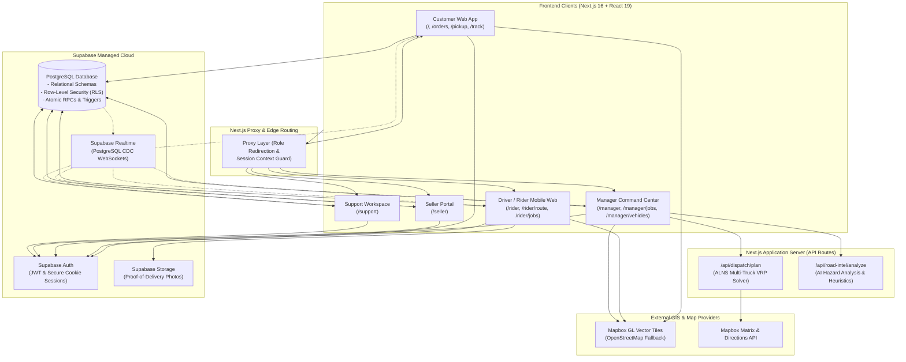
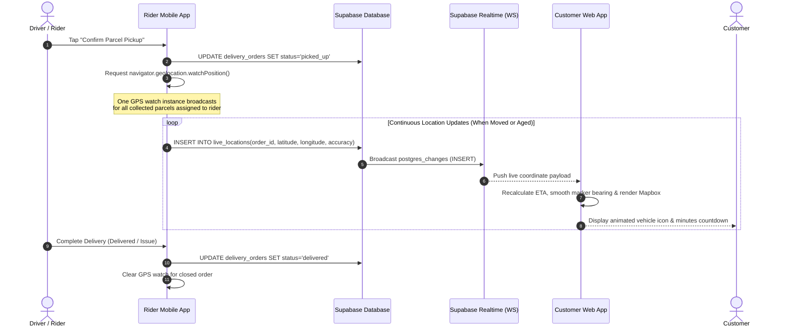
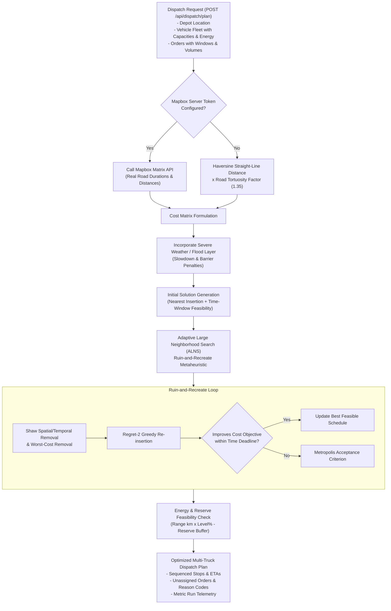
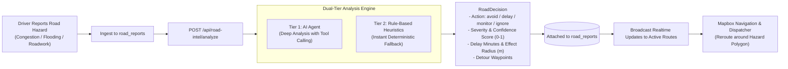
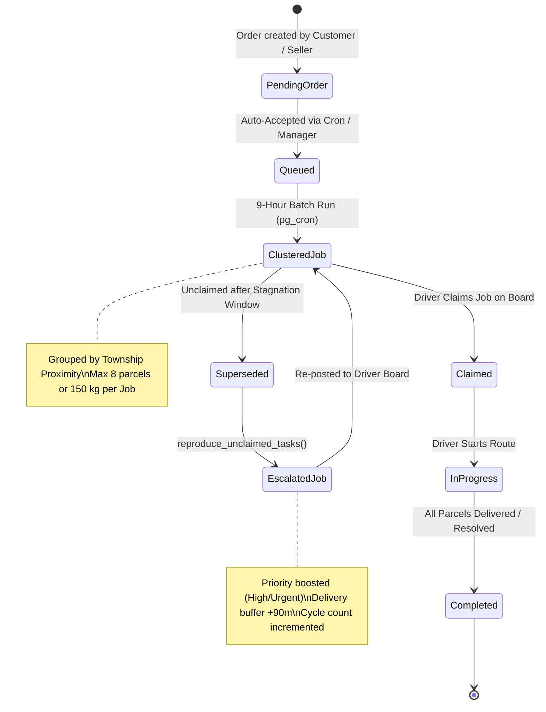

# System Architecture

This document describes the technical architecture, design patterns, and subsystem interactions of the **Oern Door-to-Door Delivery Platform**.

---

## 1. High-Level Architecture Overview

Oern is architected around a reactive, event-driven model connecting mobile web clients for field riders and customers to an administrative command hub and an optimization core backed by Supabase PostgreSQL.



---

## 2. Frontend Layer (Next.js 16 & React 19)

### 2.1 Role-Based Route Splitting
The application enforces strict separation of concerns across platform roles using URL namespaces:
- `/` (default route) redirects unauthenticated visitors to `/welcome` and authenticated customers to `/home`.
- `/rider/*` serves a touch-optimized, high-contrast mobile web interface tailored for motorcycle and van couriers.
- `/manager/*` provides an operations dashboard with map telemetry, batch dispatch controls, vehicle fleet management, and financial ledgers.
- `/seller/*` provides merchant order creation, e-commerce channel registration, and external shipment tracking.
- `/support/*` provides customer service ticket investigation, timeline auditing, and dispute logging.

### 2.2 Navigation Proxy vs. Security Boundary
Next.js Proxy acts as an onboarding and routing accelerator:
```
Signed-in User -> Proxy reads auth session -> Looks up profile role -> Redirects to role workspace
```
> [!IMPORTANT]
> The Next.js Proxy redirect is a user navigation aid, **not** the security boundary. The true security boundary is enforced strictly inside PostgreSQL via Row-Level Security (RLS) policies. Even if a malicious user alters client-side code to navigate to `/manager`, PostgreSQL immediately rejects unauthorized reads and mutations with an empty response or an RLS permission error.

### 2.3 Responsive & Hardware-Aware UI
- **Mobile Couriers (`/rider`):** Designed for single-hand mobile operation on two-wheelers, utilizing bottom action sheets, swipe-to-confirm gestures, high-contrast typography, and native canvas image compression for proof-of-delivery (POD) photo capture.
- **Dispatch Command Hub (`/manager`):** Designed for wide multi-monitor desktop environments with split-screen GIS maps, live telemetry tables, collapsible drawer sidebars, and real-time KPI metrics.

---

## 3. Real-Time Telemetry & Geolocation Subsystem

Customer live tracking is the central product guarantee of Oern: once a parcel is marked `picked_up`, the customer can follow its live location and dynamic ETA until delivery.



### 3.1 Efficient Multi-Parcel GPS Broadcasting
To minimize battery drain and avoid duplicate browser geolocation listeners, [`src/lib/delivery/use-rider-location.ts`](file:///Users/happer/Projects/oern/src/lib/delivery/use-rider-location.ts) binds a single `watchPosition` observer to all collected orders. When a new coordinate arrives:
1. It verifies spatial displacement (movement threshold > 10m) and temporal freshness (delta > 5s).
2. It broadcasts location inserts across all active, collected parcels assigned to that driver in one batch.
3. Once an order reaches a terminal state (`delivered`, `failed`, or `cancelled`), it is automatically unlinked from the location broadcaster.

### 3.2 Inverted Security View
To prevent unauthorized users from scraping entire fleet locations, public and customer tracking reads coordinates through an invoker-security view (`latest_delivery_locations`). RLS rules verify that:
- The requesting user is the customer who created the order, OR
- The requesting user is the assigned driver, OR
- The requesting user has the `manager` role.
- Furthermore, coordinates are only emitted when order status is in `["picked_up", "in_transit"]`.

---

## 4. Multi-Truck Dispatch Optimization Engine (VRP)

The dispatch optimization engine in [`src/lib/delivery/dispatch/`](file:///Users/happer/Projects/oern/src/lib/delivery/dispatch/) solves the **Pickup and Delivery Problem with Time Windows (PDPTW)**, vehicle capacities, and electric/fuel range constraints.



### 4.1 Cost Function Formulation
The solver optimizes an objective function balancing route distance, transit time, unserved penalties, and territory cohesion:
\[
\text{Cost} = \sum_{r \in \text{Routes}} \left( c_{\text{dist}} \cdot D_r + c_{\text{time}} \cdot T_r + c_{\text{fixed}} \cdot \mathbf{1}_{\{|r| > 0\}} \right) + \sum_{o \in \text{Unserved}} P_o + \text{Penalty}_{\text{flood}} + \text{Penalty}_{\text{late}}
\]

### 4.2 Energy & Electric Vehicle Reserve Constraints
For EV and fuel-constrained fleets:
- **Usable Range:**
  \[
  \text{Range}_{\text{usable}} = \text{Range}_{\text{full}} \times \left( \frac{\text{CurrentLevel}\% - \text{Reserve}\%}{100} \right)
  \]
- If the planned route length exceeds \(\text{Range}_{\text{usable}}\), the optimizer rejects vehicle assignment, returning an explainable code (`insufficient_energy`) so the dispatcher can schedule a recharge or fuel stop.

---

## 5. Road Intelligence & Severe Weather Watch Subsystem

The road intelligence subsystem in [`src/lib/delivery/road-intel/`](file:///Users/happer/Projects/oern/src/lib/delivery/road-intel/) converts field driver reports and weather hazards into actionable routing constraints.



### 5.1 Dual-Tier Inference Engine
1. **Tier 1 (AI Agent Analysis):** When LLM inference is enabled, the agent queries spatial tools (`get_speed_samples`, `get_active_orders_near_hazard`) and examines text descriptions to determine if the road is impassable.
2. **Tier 2 (Heuristic Fallback):** If API keys are missing or timeouts occur, deterministic heuristic rules classify severity based on keywords (e.g., "flooded", "under water", "tree fallen", "gridlock") and spatial proximity.
3. **Detour Waypoints:** When an `avoid` action is decreed with high confidence, [`detourWaypoints()`](file:///Users/happer/Projects/oern/src/lib/delivery/road-intel/detour.ts) computes perpendicular offset waypoints outside the hazard radius, steering route polyline calculations around the obstruction.

---

## 6. Automated Job Board & Batching Queue

To automate high-volume dispatch across townships, Oern implements a self-healing 9-hour batching queue:



- **Cron Schedule:** Runs every 9 hours (checked hourly by `pg_cron`), clustering pending orders by delivery township and geographic proximity.
- **Task Reproduction & Escalation (`reproduce_unclaimed_tasks`):** Orders that remain unclaimed when the next calculation cycle runs are extracted, escalated in priority (`normal` → `high` → `urgent`), given an extended delivery buffer (+90 minutes), and re-posted with visual urgency badges for couriers.
- **Concurrency & Atomicity:** Database functions use row-level locking (`FOR UPDATE`) to ensure two couriers cannot claim the same job batch simultaneously.

---

## 7. State Synchronization & Realtime Coordination

To keep customer, driver, and manager screens synchronized without page reloads, [`src/lib/delivery/workspace-realtime.ts`](file:///Users/happer/Projects/oern/src/lib/delivery/workspace-realtime.ts) orchestrates Supabase Realtime channels.

- **Deduplication & Chronological Ordering:** Inbound status events and location pings are indexed by timestamp and identifier. Out-of-order WebSocket arrivals are reconciled before updating React state.
- **Session Cleanup:** When an account signs out or switches roles, active channels and queued callbacks are torn down cleanly, preventing memory leaks and cross-tenant data contamination.
