# Database Schema & Security Model

This document specifies the PostgreSQL data model, database functions (RPCs), and Row-Level Security (RLS) policies powering the **Oern Delivery Platform**.

---

## 1. Entity-Relationship Diagram (ERD)

```mermaid
erDiagram
    profiles ||--o{ driver_profiles : "extends (1:1)"
    profiles ||--o{ delivery_orders : "creates as customer"
    profiles ||--o{ delivery_routes : "executes as driver"
    profiles ||--o{ road_reports : "submits as driver"
    profiles ||--o{ support_cases : "files or handles"

    vehicles ||--o{ delivery_routes : "assigned to"
    vehicles ||--o{ vehicle_maintenance_records : "logs"
    vehicles ||--o{ delivery_cost_entries : "incurs"

    delivery_orders ||--o{ delivery_assignments : "assigned via"
    delivery_orders ||--o{ delivery_stops : "visited at"
    delivery_orders ||--o{ delivery_locations : "tracks"
    delivery_orders ||--o{ delivery_status_events : "status timeline"
    delivery_orders ||--o{ delivery_outcome_reports : "concluded by"
    delivery_orders ||--o{ cod_payments : "settles cash"
    delivery_orders ||--o{ delivery_order_logistics : "planning attributes"

    delivery_routes ||--o{ route_stops : "sequences"
    delivery_routes ||--o{ driver_route_sessions : "tracks state"

    job_batches ||--o{ delivery_jobs : "groups"
    delivery_jobs ||--o{ delivery_queue : "contains orders"
    delivery_jobs ||--o| delivery_routes : "materializes into"

    dispatch_runs ||--o{ dispatch_run_routes : "schedules"
    dispatch_runs ||--o{ dispatch_run_orders : "allocates"
    dispatch_runs ||--o{ dispatch_run_stops : "orders"
    depots ||--o{ dispatch_runs : "originates from"

    road_reports ||--o| road_report_decisions : "evaluated by"
```

---

## 2. Core Tables by Domain

### 2.1 Identity, Fleet & Maintenance

#### `profiles`
Central user registry linked to `auth.users.id`.
- `id` (`uuid`, PK, FK `auth.users.id`): Unique user identifier.
- `role` (`text`, NOT NULL): User role (`customer`, `driver`, `manager`, `seller`, `support`). Default: `customer`.
- `full_name` (`text`): Display name of user.
- `phone` (`text`): Primary contact phone number.
- `created_at` (`timestamptz`): Registration timestamp.

#### `driver_profiles`
Operational metadata for courier riders and drivers.
- `id` (`uuid`, PK, FK `profiles.id`): Driver profile identifier.
- `license_number` (`text`): Driver license ID.
- `availability` (`text`): Duty status (`available`, `on_delivery`, `off_duty`).
- `rating` (`numeric`): Rolling performance score.
- `created_at` / `updated_at` (`timestamptz`).

#### `vehicles`
Fleet vehicles (motorcycles, vans, electric trucks).
- `id` (`uuid`, PK): Unique vehicle identifier.
- `registration_number` (`text`, UNIQUE): License plate number.
- `vehicle_type` (`text`): Classification (`motorcycle`, `van`, `truck`).
- `status` (`text`): Status (`active`, `maintenance`, `inactive`).
- `energy_source` (`text`): Fuel type (`fuel`, `electric`, `hybrid`).
- `fuel_level_percent` (`numeric`): Current fuel tank fill percentage (0–100).
- `battery_level_percent` (`numeric`): Current EV battery charge percentage (0–100).
- `range_km_at_full` (`numeric`): Total operational range on 100% tank/battery.
- `reserve_percent` (`numeric`, DEFAULT 15): Safety reserve threshold below which vehicle cannot be dispatched.
- `capacity_kg` (`numeric`): Maximum allowable cargo payload weight.
- `odometer_km` (`numeric`): Current odometer reading.
- `service_due_at_km` (`numeric`): Odometer milestone for next maintenance.

#### `vehicle_maintenance_records`
Scheduled service and repair records.
- `id` (`uuid`, PK): Maintenance event ID.
- `vehicle_id` (`uuid`, FK `vehicles.id`): Maintained vehicle.
- `maintenance_type` (`text`): Type (`oil_change`, `tire_replacement`, `battery_service`, `brake_inspection`, `general_repair`).
- `odometer_km` (`numeric`): Vehicle mileage at service.
- `cost` (`numeric`): Total maintenance cost in MMK.
- `notes` (`text`): Maintenance summary and garage details.
- `performed_at` (`timestamptz`): Date service was completed.

#### `delivery_cost_entries`
Direct operating expenses allocated to vehicles and shifts.
- `id` (`uuid`, PK): Expense record ID.
- `vehicle_id` (`uuid`, FK `vehicles.id`): Associated vehicle.
- `cost_type` (`text`): Expense category (`fuel`, `charging`, `toll`, `labor`, `other`).
- `amount` (`numeric`): Expenditure amount in MMK.
- `incurred_at` (`timestamptz`): Time of expense.

---

### 2.2 Orders, Route Stops & Deliveries

#### `delivery_orders`
Primary shipment entity for customer and manager orders.
- `id` (`uuid`, PK): Order identifier.
- `tracking_code` (`text`, UNIQUE): Public human-readable tracking code (e.g., `ORD-20261023-XXXX`).
- `customer_id` (`uuid`, FK `profiles.id`, NULLABLE): Nullable for guest/phone orders.
- `customer_name` (`text`): Sender or customer contact name.
- `status` (`text`, NOT NULL): Current lifecycle status (`pending`, `assigned`, `accepted`, `picked_up`, `in_transit`, `delivered`, `failed`, `cancelled`).
- `pickup_address` (`text`), `delivery_address` (`text`): Formatted addresses.
- `pickup_latitude` / `pickup_longitude` (`double precision`): Pickup coordinates.
- `delivery_latitude` / `delivery_longitude` (`double precision`): Delivery coordinates.
- `recipient_name` (`text`), `recipient_phone` (`text`): Recipient details.
- `pickup_contact_name` (`text`), `pickup_contact_phone` (`text`): Contact at pickup.
- `parcel_description` (`text`), `parcel_weight_kg` (`numeric`): Cargo properties.
- `cod_amount` (`numeric`, DEFAULT 0): Amount to collect upon delivery.
- `cod_status` (`text`, DEFAULT `'pending'`): COD lifecycle (`not_required`, `pending`, `collected`, `settled`).
- `estimated_delivery_at` (`timestamptz`): Dynamically recalculated ETA.
- `route_progress_percent` (`numeric`): Calculated percentage along route (0–100).
- `traffic_delay_minutes` (`integer`, DEFAULT 0): Accumulated road/weather delay.

#### `delivery_assignments`
Atomic binding between an order, driver, and vehicle.
- `id` (`uuid`, PK): Assignment record ID.
- `order_id` (`uuid`, FK `delivery_orders.id`, UNIQUE): Order assigned.
- `driver_id` (`uuid`, FK `profiles.id`): Assigned courier.
- `vehicle_id` (`uuid`, FK `vehicles.id`, NULLABLE): Assigned vehicle.
- `assigned_by` (`uuid`, FK `profiles.id`): Manager who performed assignment.
- `assigned_at` (`timestamptz`): Timestamp of assignment.

#### `delivery_routes` & `route_stops`
Driver route manifests and stop sequences.
- `delivery_routes`: Contains `id`, `driver_id`, `vehicle_id`, `status` (`planned`, `in_progress`, `completed`, `cancelled`), `service_date`, `dispatch_run_id`.
- `route_stops`: Contains `id`, `route_id`, `order_id`, `stop_type` (`pickup`, `delivery`), `sequence_number`, `status` (`pending`, `arrived`, `completed`, `failed`), `arrived_at`, `completed_at`.

#### `delivery_locations`
GPS breadcrumbs streamed from driver devices.
- `id` (`bigint`, PK GENERATED ALWAYS AS IDENTITY): Sequential location ID.
- `order_id` (`uuid`, FK `delivery_orders.id`): Associated order.
- `driver_id` (`uuid`, FK `profiles.id`): Broadcasting driver.
- `latitude` / `longitude` (`double precision`): Geocoordinates.
- `accuracy_meters` (`numeric`): GPS horizontal accuracy radius.
- `recorded_at` (`timestamptz`): Time coordinate was captured by device.

#### `delivery_outcome_reports`
Closing delivery report filed by driver upon stop completion.
- `order_id` (`uuid`, PK, FK `delivery_orders.id`): Order closed.
- `outcome` (`text`, NOT NULL): `delivered` or `failed`.
- `recipient_name` (`text`): Person who received parcel.
- `cod_collected` (`numeric`): Actual cash collected.
- `cod_discrepancy_reason` (`text`): Reason if collected != expected.
- `failure_reason` (`text`): Cause of failure (e.g., `customer_unavailable`, `wrong_address`, `damaged_goods`).
- `proof_photo_url` (`text`): Supabase Storage URL for POD photo.
- `reported_at` (`timestamptz`): Time report was submitted.

---

### 2.3 Job Board & Queue Automation

#### `job_batches`
A scheduled or automated grouping run.
- `id` (`uuid`, PK): Batch identifier.
- `trigger` (`text`): Trigger source (`schedule`, `manual`, `automation`, `reproduce`).
- `job_count` (`integer`), `order_count` (`integer`): Batch totals.
- `created_at` (`timestamptz`).

#### `delivery_jobs`
A cluster of orders posted to the driver job board.
- `id` (`uuid`, PK): Job identifier.
- `batch_id` (`uuid`, FK `job_batches.id`): Originating batch run.
- `label` (`text`): Friendly name (e.g., `Job #A12 - Kamayut North`).
- `area_label` (`text`): Township or cluster area (e.g., `Hlaing`, `Bahan`).
- `status` (`text`): Job status (`open`, `claimed`, `in_progress`, `completed`, `cancelled`, `superseded`).
- `order_count` (`integer`): Number of orders in job (capped at 8).
- `total_weight_kg` (`numeric`): Total weight (capped at 150 kg).
- `cod_total` (`numeric`): Sum of all COD to collect.
- `claimed_by` (`uuid`, FK `profiles.id`, NULLABLE): Driver who took job.
- `priority` (`text`, DEFAULT `'normal'`): Priority level (`low`, `normal`, `high`, `urgent`).
- `reproduce_count` (`integer`, DEFAULT 0): Times this job was reproduced after going unclaimed.

#### `delivery_queue`
Orders waiting to be bundled into delivery jobs.
- `order_id` (`uuid`, PK, FK `delivery_orders.id`): Queued order.
- `queued_at` (`timestamptz`): When order entered queue.
- `job_id` (`uuid`, FK `delivery_jobs.id`, NULLABLE): Job assigned to.
- `auto_accepted` (`boolean`, DEFAULT FALSE): Whether accepted automatically by cron.

---

### 2.4 Multi-Truck Dispatch Optimization

- `depots`: Operational dispatch hubs with fixed latitude/longitude.
- `dispatch_runs`: Solved VRP runs containing algorithm configuration, runtime duration, status (`draft`, `committed`, `discarded`), total cost, and unassigned order IDs.
- `dispatch_run_routes`: Vehicle route assignments created by the optimizer.
- `dispatch_run_stops`: Chronologically sequenced stops with planned arrival and departure windows.
- `dispatch_run_matrices`: Cached duration and distance matrices between all problem waypoints.

---

### 2.5 Road Intelligence & Incident Reporting

#### `road_reports`
Driver-submitted road condition reports.
- `id` (`uuid`, PK): Report ID.
- `driver_id` (`uuid`, FK `profiles.id`): Submitting driver.
- `order_id` (`uuid`, FK `delivery_orders.id`, NULLABLE): Active order at report time.
- `category` (`text`): Condition (`congestion`, `closure`, `roadwork`, `flooding`, `hazard`).
- `severity` (`text`): Severity (`low`, `medium`, `high`, `blocked`).
- `description` (`text`): Driver notes.
- `latitude` / `longitude` (`double precision`): Coordinate of hazard.
- `status` (`text`): Verification status (`pending`, `verified`, `rejected`).
- `reported_at` / `expires_at` (`timestamptz`).

#### `road_report_decisions`
Automated AI analysis and routing verdicts.
- `report_id` (`uuid`, PK, FK `road_reports.id`): Analyzed report.
- `action` (`text`): Routing action (`avoid`, `delay`, `monitor`, `ignore`).
- `confidence` (`numeric`): Confidence rating (0.0 to 1.0).
- `delay_minutes` (`integer`): Estimated transit delay to apply.
- `radius_meters` (`integer`): Geographic radius of impact.
- `rationale` (`text`): Machine or heuristic reasoning.
- `source` (`text`): Analysis source (`agent` or `heuristic`).

---

## 3. Database Functions & Stored Procedures (RPCs)

The delivery platform relies on transactional PostgreSQL functions to guarantee ACID semantics:

| Function Name | Security Context | Purpose & Behavioral Guarantees |
| :--- | :--- | :--- |
| `create_customer_pickup_order` | `SECURITY DEFINER` | Validates input coordinates, creates a customer pickup order in `pending` status, writes initial stop rows, and logs a creation status event in one transaction. |
| `create_manual_delivery_order` | `SECURITY INVOKER` | Allows managers or sellers to enter an order directly into the fulfillment queue. |
| `assign_delivery` | `SECURITY DEFINER` | Performs atomic rider assignment. Locks the target order with `FOR UPDATE`; rejects reassignment if the order is already `picked_up` or `delivered`. |
| `claim_delivery_job` | `SECURITY DEFINER` | Atomically claims an open job for the calling driver. Checks that driver has no active unfinished route, transitions job status to `claimed`, and assigns all child orders to the driver. |
| `release_delivery_job` | `SECURITY DEFINER` | Returns an unstarted job to the board, clearing driver assignments and setting job status back to `open`. |
| `auto_accept_orders` | `SECURITY DEFINER` | Scans pending orders, marks them accepted, and places them into `delivery_queue`. |
| `reproduce_unclaimed_tasks` | `SECURITY DEFINER` | Extracts orders from stagnant unclaimed jobs, supersedes the old jobs, escalates priority to `high` or `urgent`, extends delivery windows by 90m, and bundles them into new priority jobs. |
| `run_auto_accept_and_reproduce_workflow` | `SECURITY DEFINER` | Master automation orchestrator combining auto-acceptance, stagnation extraction, job reproduction, and batch creation. |
| `save_dispatch_run` | `SECURITY INVOKER` | Persists a solved VRP dispatch plan (`dispatch_runs`, routes, stops, and cached matrices). |
| `commit_dispatch_run` | `SECURITY INVOKER` | Materializes a draft dispatch plan into live `delivery_routes`, `route_stops`, and order assignments. |
| `complete_delivery` | `SECURITY DEFINER` | Records final delivery outcome, verifies COD collected amount, uploads proof-of-delivery photo link, and transitions order status to `delivered` or `failed`. |
| `review_road_report` | `SECURITY INVOKER` | Allows managers to verify or reject pending driver road notes. |
| `track_delivery` | `SECURITY DEFINER` | Public tracking lookup function returning order status and permitted location for a tracking code. |

---

## 4. Row-Level Security (RLS) Permission Matrix

Row-Level Security is enabled on every table. The table below details access rights across roles:

| Table Name | `customer` | `driver` | `manager` | `seller` | `support` | `anon` / Public |
| :--- | :--- | :--- | :--- | :--- | :--- | :--- |
| `profiles` | Own row (R/W) | Own row (R/W) | All (R/W) | Own row (R/W) | All (R) | None |
| `driver_profiles` | None | Own row (R/W) | All (R/W) | None | All (R) | None |
| `vehicles` | None | Assigned (R) | All (R/W) | None | All (R) | None |
| `delivery_orders` | Own orders (R) | Assigned (R/W) | All (R/W) | Own store (R/W) | All (R) | Via RPC only |
| `delivery_assignments` | Own orders (R) | Own assign (R) | All (R/W) | Own store (R) | All (R) | None |
| `delivery_routes` | None | Own route (R/W) | All (R/W) | None | All (R) | None |
| `route_stops` | None | Own stops (R/W) | All (R/W) | None | All (R) | None |
| `delivery_locations` | Own active orders (R) | Assigned (W) | All (R) | None | All (R) | None |
| `delivery_jobs` | None | Open & Own (R/W) | All (R/W) | None | None | None |
| `road_reports` | None | Own (W), All (R) | All (R/W) | None | All (R) | None |
| `cod_payments` | Own orders (R) | Collected (W) | All (R/W) | None | All (R) | None |
| `vehicle_maintenance` | None | None | All (R/W) | None | None | None |
| `delivery_cost_entries`| None | None | All (R/W) | None | None | None |
| `support_cases` | Own cases (R/W) | None | All (R/W) | Own store (R/W) | All (R/W) | None |
| `commerce_integrations`| None | None | All (R) | Own store (R/W) | All (R) | None |

> [!NOTE]
> `(R)` = SELECT permission, `(W)` = INSERT/UPDATE permission, `(R/W)` = Full CRUD permission.
