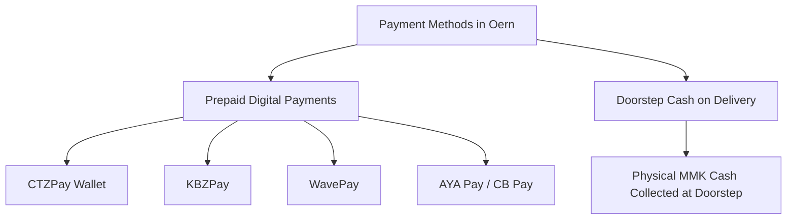
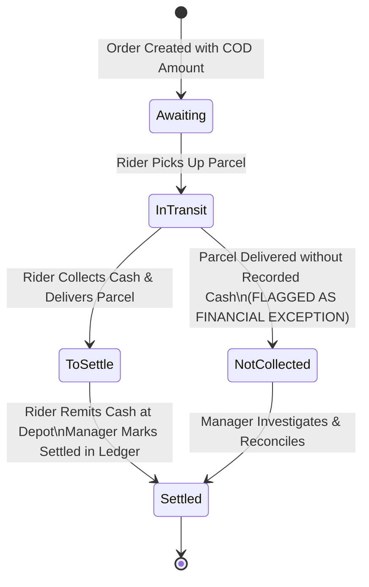
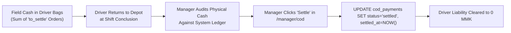

# Cash on Delivery (COD) & Payment Ecosystem

This document describes the financial workflows, cash-handling models, digital wallet integrations, and ledger reconciliation mechanisms implemented in the **Oern Delivery Platform**.

---

## 1. Operating Context & Payment Philosophy

In Southeast Asian and Myanmar e-commerce logistics, **Cash on Delivery (COD)** represents a critical portion of customer transactions. Managing cash in the field requires real-time liability tracking, discrepancy reporting, and end-of-day remittance settlement.

Oern supports both digital prepaid wallets and physical cash collection, providing accounting visibility from doorstep collection to depot settlement.

---

## 2. Supported Payment Methods

### 2.1 Prepaid Digital Payments
- **Supported Providers:** CTZPay, KBZPay, WavePay, AYA Pay, CB Pay.
- **Workflow:** Senders or buyers prepay the order fee and merchandise amount prior to courier arrival.
- **Accounting Treatment:** The courier holds **0 MMK cash liability** for prepaid shipments. The delivery stop requires proof of delivery (POD) but bypasses cash entry.

### 2.2 Cash on Delivery (COD)
- **Workflow:** The courier is instructed to collect an exact sum (`cod_amount`) from the recipient before handing over the parcel.
- **Accounting Treatment:** Upon confirming collection, the collected amount immediately increments that driver's **in-field cash liability**.

---

## 3. The COD Reconciliation Lifecycle

### 3.1 Order COD States
The reconciliation engine in [`src/lib/delivery/cod-ledger.ts`](file:///Users/happer/Projects/oern/src/lib/delivery/cod-ledger.ts) categorizes every order into one of four financial states:

| COD State | Condition | Operational Implication |
| :--- | :--- | :--- |
| `awaiting` | Order active and not yet delivered. | Anticipated cash; no liability yet incurred. |
| `to_settle` | Driver recorded cash collection; order delivered. | Physical cash is currently held by courier in the field. |
| `not_collected` | Order delivered, but zero cash recorded. | **Critical Exception:** Manager must investigate immediately. |
| `settled` | Cash received at depot and confirmed by manager. | Transaction closed; liability cleared. |

### 3.2 Handling Discrepancies at the Doorstep
If the cash collected differs from the expected amount, the courier must enter an explanation before completing the delivery:
\[
\text{Difference} = \text{Amount}_{\text{collected}} - \text{Amount}_{\text{expected}}
\]
- **Underpayment:** e.g., recipient short by 500 MMK; discrepancy reason logged (e.g., `"Customer lacked small change; merchant approved rounding"`).
- **Overpayment:** e.g., tip or round-up added by customer.
- **Zero Collection:** If a COD parcel is handed over without cash, the ledger ranks this row at the very top of the manager's exception view with high visual urgency.

---

## 4. Manager Financial Ledger & Remittance (`/manager/cod`)

### 4.1 Driver Liability Ledger
The manager's COD dashboard consolidates:
- **Total In-Field Exposure:** Aggregated cash currently held across all active couriers.
- **Per-Driver Cash Liability:** Sum of collected cash awaiting handover for each individual driver.
- **Delivered Unpaid Exceptions:** Quick-filter isolating all deliveries where cash collection failed.

### 4.2 End-of-Shift Remittance Workflow
1. At shift completion, the driver reports to the dispatch office with physical cash.
2. The manager opens `/manager/cod` and filters by the driver's name.
3. The screen displays the exact total to collect, itemized parcel by parcel with any documented discrepancy notes.
4. Once the manager verifies cash in hand, clicking **"Settle Remittance"** transitions all associated records to `settled`, stamping the date, time, and settling manager's ID.
