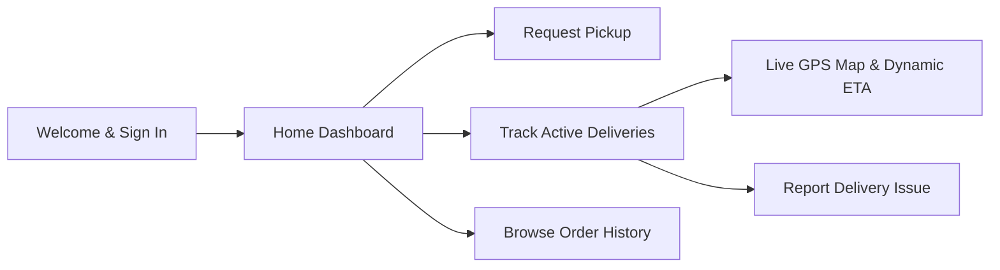
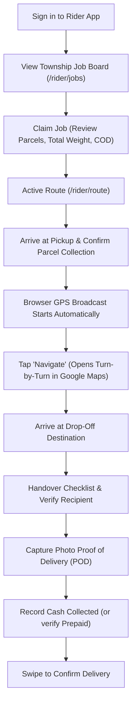
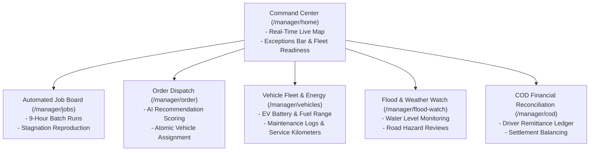

# Role Workspaces & Operations Manual

This guide provides operational walkthroughs and workflows for the five user roles on the **Oern Delivery Platform**: Customer, Driver/Rider, Dispatch Manager, Merchant Seller, and Customer Support Agent.

---

## 1. Customer Experience (`/`, `/home`, `/orders`, `/pickup`, `/track`)

### 1.1 Door-to-Door Pickup Request
Customers can order on-demand parcel collection from their home or business in three steps:
1. **Step 1 - Pickup & Drop-Off Locations:** Enter sender pickup address and recipient drop-off address. Customers can tap map pins to geocode precise building entrances.
2. **Step 2 - Parcel & Recipient Details:** Provide recipient contact name, phone number, parcel weight (kg), and item description.
3. **Step 3 - Payment Method Selection:**
   - **Cash on Delivery (COD):** The recipient pays the driver upon drop-off.
   - **Prepaid Digital Wallet (CTZPay):** The sender prepays in-app; the driver collects no cash.
4. **Submission:** Tap "Confirm Pickup Request". A unique tracking number (`ORD-XXXXXX`) is generated instantly, and the order appears on the manager's dispatch queue.

### 1.2 Live Real-Time Parcel Tracking (`/track`)
- **Live Location:** Once a courier collects the parcel, the customer map renders an animated vehicle marker displaying live GPS movements.
- **Dynamic ETA:** Recalculates dynamically based on driver route progress and road speed.
- **Status Stepper:** Shows chronological stage progression (`assigned` → `accepted` → `picked_up` → `in_transit` → `delivered`).
- **Support Escalation:** If an order is delayed or encounters an issue, customers can tap "Need Help?" to open a direct support ticket.

---

## 2. Driver & Rider Mobile Operations (`/rider`, `/rider/route`, `/rider/jobs`)

The courier mobile application is designed for rapid one-handed mobile operation.

### 2.1 Claiming Jobs from the Township Board
- Couriers without an active route browse open delivery jobs clustered by township (e.g., `Kamayut`, `Hlaing`, `Bahan`).
- Each job card shows:
  - Total parcel count (e.g., 6 parcels).
  - Aggregate cargo weight (e.g., 28 kg).
  - Total COD amount to be collected (e.g., 85,000 MMK).
  - Priority badge (`normal`, `high`, `urgent`).
- Couriers tap **"Take Job"** to atomically lock the job and load stops into their active route manifest.

### 2.2 Stop Sequencing & Navigation
- Couriers execute stops in sequence. Tapping **"Navigate"** triggers a deep link into Google Maps with pre-populated destination coordinates.
- If a destination cannot be reached immediately (e.g., recipient requested delivery 1 hour later), the courier can tap **"Try Later"**. The engine intelligently reinserts the stop into the route sequence to minimize overall detour distance.

### 2.3 Proof of Delivery (POD) & Photo Capture
1. Tap **"Complete Stop"** upon reaching recipient.
2. Verify recipient identity.
3. Tap the camera icon to capture a photo of the handed-over parcel. The app automatically resizes and compresses the image on a client-side canvas before uploading to secure Supabase Storage.
4. Input collected COD amount. If the customer paid short or extra, enter the discrepancy reason.
5. Perform **"Swipe to Confirm"** to close the stop.

### 2.4 Submitting Road Incidents & Assistance
- **Road Hazard Report:** Couriers encountering road blockages, heavy flooding, or construction tap **"Report Road"**, select category and severity, and submit. This alerts dispatchers and feeds the routing engine.
- **Assistance Request:** If vehicle battery/fuel drops to emergency levels or a breakdown occurs, couriers tap **"Request Assistance"** to notify operations.

---

## 3. Dispatch & Fleet Management Hub (`/manager`)

### 3.1 Live Command Center & Exception Triage
The manager home screen consolidates operational intelligence:
- **Urgent Attention Strip:** Highlighting stale GPS pings (>15 min), unassigned orders nearing service windows, driver assistance requests, and collected cash exposure.
- **Unified Fleet Map:** Displays all live courier positions, route paths, and active order pins.

### 3.2 Automated Batching & Job Board Governance
- Runs automated clustering every 9 hours via `pg_cron`.
- Managers can manually trigger **"Run Auto-Accept & Batch"** at any time.
- Unclaimed jobs that have lingered beyond the pickup threshold can be reproduced with a single click via **"Reproduce Unclaimed Tasks"**, automatically escalating their priority to `high` or `urgent` and adding a 90-minute delivery buffer.

### 3.3 Atomic Assignment & Explainable AI Recommendations
When manually assigning an order:
1. Select an unassigned pending order.
2. The recommendation engine evaluates couriers and vehicles, outputting an explainable score based on:
   - Courier proximity to pickup.
   - Current active delivery workload.
   - Vehicle payload capacity vs. parcel weight.
   - EV battery/fuel range vs. expected route distance.
3. Click **"Assign Courier"** to execute atomic assignment in Supabase.

### 3.4 Severe Weather & Flood Watch Management
- View GIS flood zones overlaid on Yangon city maps.
- Review driver-submitted road notes.
- When an AI hazard recommendation arrives with an `avoid` action, managers click **"Verify Report"** to activate detour waypoints on active courier navigation routes.

---

## 4. Merchant Seller Portal (`/seller`)

Designed for e-commerce vendors and retail shops dispatching daily merchandise.
- **Store Registration:** Connect storefronts and logistics carrier channels.
- **Bulk Pickup Creation:** Upload orders via quick entry forms with automated fee estimation based on package weight, distance, and payment method.
- **Unified Shipment Queue:** View both local Oern door deliveries and third-party logistics shipments in one consolidated tracking table.

---

## 5. Customer Support Workspace (`/support`)

Customer service representatives handle inbound inquiries and delivery exceptions:
- **Universal Search:** Search orders by tracking code, customer name, recipient phone number, or external carrier tracking ID.
- **Audit Timeline:** Review full status history events, timestamped location breadcrumbs, and driver outcome notes.
- **Case Investigation & Resolution:** Assign tickets to support agents, document customer conversations, and record resolution classifications (`re-dispatched`, `refunded`, `closed`).
