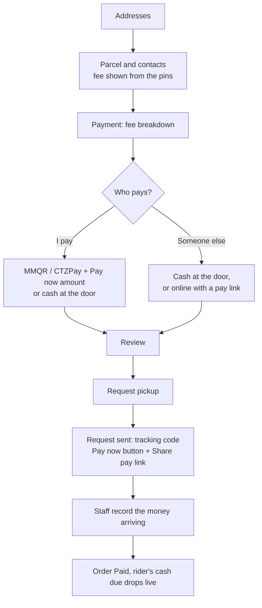

# Payment UX Flows

How each role chooses, pays and sees payment for an order. Three methods are offered, in this order:

| Method | Type | Who pays | When | Rider collects |
| :--- | :--- | :--- | :--- | :--- |
| **MMQR** | Prepaid | Sender, by scanning a QR in any Myanmar bank or wallet app (KBZPay, AYA Pay, CB Pay, Wave and others that support MMQR) | After the request is sent, before pickup | Nothing for the fee |
| **CTZPay** | Prepaid | Sender, from their CTZPay wallet | After the request is sent, before pickup | Nothing for the fee |
| **Cash on delivery** | Cash | Receiver, in cash at the door | At drop-off | Fee plus any goods amount |

MMQR comes first because it works with whatever app the customer already has. CTZPay is second for customers who keep a CTZPay balance. Cash is last, and stays the default when nothing is chosen, because nobody is turned away.

### Pay any amount now, the rest is COD

With MMQR or CTZPay the customer chooses how much to pay now, from nothing up to the full amount owed (delivery fee plus any goods). Whatever is left becomes the cash on delivery, so the rider's COD is reduced by what was paid. Once nothing is left, the order shows **Paid**.

| Paid now | Order is stored with | Customer sees | Rider collects |
| :--- | :--- | :--- | :--- |
| Full amount | `cod_amount = 0`, `Payment: prepaid MMQR 8300 MMK` | *Paid · MMQR* | Nothing |
| Part, e.g. 5,000 of 8,300 | `cod_amount = 3300`, `Payment: prepaid MMQR 5000 MMK` | *Paid MMK 5,000 · COD due on arrival · MMK 3,300* | MMK 3,300 |
| Nothing | `cod_amount` = goods, `Payment: cash on delivery` | *COD due on arrival* | Fee plus goods |

After the rider collects the balance, the order is *Paid* too. Older prepaid orders whose text names no amount were paid in full, and still read that way.

Logic: `splitPayment`, `orderPrepaidAmount`, `isPaidInFull` and `orderPaymentStatus` in `src/lib/delivery/payment-methods.ts`. The COD ledger, the rider's cash due and the customer's COD sheet all skip orders paid in full and keep a part payment's balance as ordinary cash.

---

## 1. Customer requests a pickup (`/pickup` → `/pickup/details` → `/pickup/payment` → `/pickup/review`)

Four steps: addresses, parcel and contacts, **payment**, review.

1. **Fee up front.** As soon as both pins are set, the details step says "Delivery fee about MMK X for N km". The **Payment** step breaks it down (base, distance, handling, goods). The **Review** step repeats the fee and the payment choice, each with an Edit link back to Payment.
2. **Who pays?** *I'll pay* or *Someone else pays*. Someone else hides the method and amount choices: they pay the rider in cash, or online with a pay link.
3. **How I pay.** MMQR, CTZPay or cash. For MMQR and CTZPay, *Pay now* is the amount to send online (default: everything); the rest is cash at the door.
4. **Nothing is prepaid when the request is sent.** The order owes the whole fee plus goods as its COD, and the text says `Payment: cash on delivery`. Marking it paid before money arrives would let the rider skip cash that was never received.
5. **Pay on the next screen.** The sent screen shows **Pay MMK X now with MMQR** (opens the steps with the amount and the tracking code as reference) and **Share pay link for someone else**. It says online payment is confirmed by hand for now.
6. **Staff record it.** When the money arrives, staff use *Paid online?* on the order. The COD balance drops by that amount, the order text records the total paid, and the order reads *Part paid* or *Paid*.
7. **Live to the rider.** The order update is pushed to the rider's phone over Realtime, so the amount to collect and the *Paid online* line change at once, without a refresh.

## 2. Manager or seller creates an order (`/manager/orders/new`)

- Same picker, same order. Staff can also pay any part now; the rest is the COD. The seller's *Usual payment method* on the Business page preselects it.
- MMQR on a staff-created order means the sender pays when the order is confirmed. Staff can read the amount and reference aloud or send the QR link once it exists.
- The order text records `Payment: prepaid MMQR`, which `orderPaymentMethod` reads back until a `payment_method` column is added.

## 3. Rider at the door (`/rider`)

- Prepaid orders show *Prepaid, no cash to collect* and skip cash entry. The fee is never collected twice.
- Cash orders show the amount to collect, as today.
- No QR at the door. MMQR works from anywhere, so a receiver with no cash pays the remaining COD online instead of through the rider's phone.

### Pay the COD balance online, from anywhere

1. While an order is on its way with COD still due, the tracking page's *Cash on delivery* section shows **Pay MMK X online instead**: send the amount with MMQR or CTZPay, use the tracking code as the reference.
2. **Share pay link** sends `/track?code=…&pay=1`, which opens that section. The receiver or anyone else can pay; the link only shows the order's own tracking details.
3. Staff see the money arrive and use **Paid online?** on the order (Orders → select the order) to record the method and amount. Any amount up to the balance works.
4. The balance drops by that amount, the order text records the total paid (`Payment: prepaid MMQR 5000 MMK`), and the order reads *Part paid* or *Paid*. The rider's cash due drops with it; at 0 the rider collects nothing.

Until a provider confirms payments automatically, step 3 is manual: a customer cannot mark their own order paid. When MMQR is connected, its callback should call the same update (`recordRemoteCodPayment`).

## 4. Tracking, orders and the ledger

- Customer order screens show the method as a badge: *Prepaid · MMQR*, *Prepaid · CTZPay* or *COD*.
- Manager tables use the same badge. The Business page's payment mix counts each method.
- The COD ledger skips prepaid orders, so MMQR and CTZPay orders never appear as missing cash.

## 5. Connecting MMQR for real

A payable MMQR code is an EMVCo merchant-presented QR issued under a merchant account with an MMQR acquiring bank. Until the business has one:

- The app shows the payment steps and says plainly that online payment is not connected, so no customer scans a code that cannot be paid.
- When the merchant ID is available: build the EMVCo payload server-side (merchant ID, MMK currency `104`, amount, tracking code as bill reference, CRC), render it as a QR, and confirm payment from the acquirer's callback before marking the order paid.

## 6. States to design for

| State | Customer sees | Rider sees |
| :--- | :--- | :--- |
| Prepaid, not paid yet | *Payment pending* + Pay action | Hold pickup until paid (planned) |
| Prepaid, paid in full | *Paid · MMQR* | *Prepaid, no cash to collect* |
| Part paid | *Paid MMK X · COD due on arrival · MMK Y* | COD MMK Y |
| Balance collected | *Paid · MMK Y in cash* | Nothing more |
| Payment failed or expired | *Payment didn't go through* + Try again / Pay cash instead | No change |
| Cash | *Pay the rider X* | Amount to collect |

## 7. Payment logos

`PaymentLogo` shows licensed artwork from `public/payments/mmqr.svg` and `public/payments/ctzpay.svg` when those files exist, and a neutral icon (QR, wallet, coin) otherwise. The marks belong to their owners, so they are not bundled; see `public/payments/README.md`.
