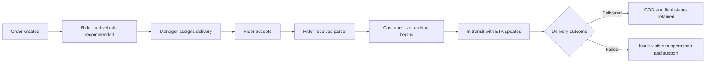
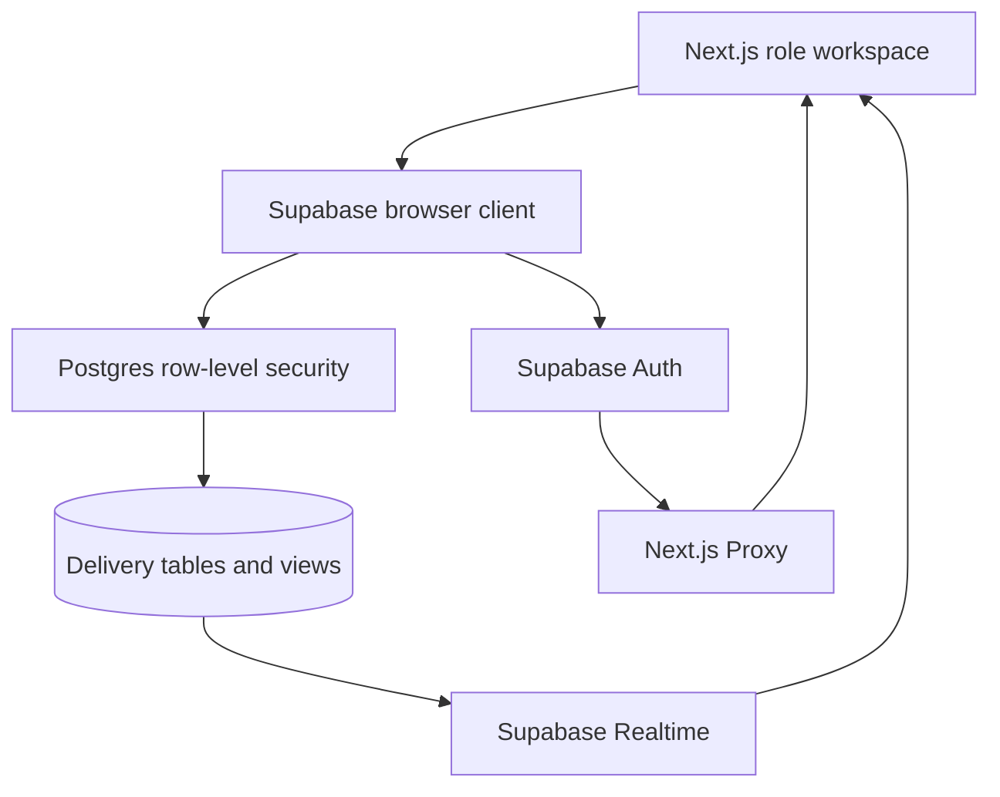

# Understand the project and delivery flow

Oern is a door-to-door delivery platform with separate customer, rider, management, seller, and support workspaces. Customer tracking remains the central product flow: live parcel location becomes available after the rider receives the parcel and continues until the delivery closes. Estimated time of arrival (ETA), Global Positioning System (GPS) updates, and cash on delivery (COD) share this delivery lifecycle.

## Interface map

| Workspace | URL | Main responsibility |
| --- | --- | --- |
| Customer | `/` | Track local and external shipments, view ETA and COD, and request support |
| Rider/driver | `/rider` | Accept tasks, confirm pickup, share GPS, report roads, collect COD, and finish delivery |
| Management | `/manager` | Create orders, manage assignments, monitor deliveries, and review road knowledge |
| Fleet insights | `/manager/insights` | Manage energy readiness, maintenance, and delivery costs |
| Seller | `/seller` | Request deliveries, register channels, import provider shipments, and monitor orders |
| Customer support | `/support` | Search delivery context, manage cases, and record resolutions |

The customer interface is the default. Next.js Proxy redirects authenticated team accounts to the workspace for their profile role.

## Delivery lifecycle

The order statuses are:

1. `pending`
2. `assigned`
3. `accepted`
4. `picked_up`
5. `in_transit`
6. `delivered`, `failed`, or `cancelled`

GPS writes are accepted only for the assigned rider after pickup and before the delivery closes. Customer access is limited to locations for their own active delivery.

## Assignment flow

1. A manager or seller creates a delivery request.
2. The manager selects a pending order.
3. The application scores available riders using workload, distance to pickup, and availability.
4. It scores compatible vehicles using status and parcel capacity.
5. The manager reviews the reasons and saves the assignment.
6. Supabase performs the assignment atomically and prevents invalid reassignment after pickup.

The recommendation is advisory. The manager remains responsible for the final assignment.

## Live tracking and predictive ETA

1. The rider accepts the delivery.
2. At parcel handoff, the rider marks the order `picked_up`.
3. The browser requests location permission and starts one GPS watch for every collected parcel assigned to that rider.
4. Supabase stores location points and exposes the latest permitted point through an invoker-security view.
5. Customer and manager workspaces subscribe through Supabase Realtime.
6. New locations recalculate route progress and ETA using remaining distance, expected vehicle speed, and verified road delays.
7. Tracking stops when the delivery is delivered, failed, or cancelled.

ETA is an operational prediction. It does not currently call a live traffic or street-routing provider.

## Road-knowledge flow

1. A rider submits a categorized road report with the current location.
2. The report begins in `pending` state and is visible to the rider and managers.
3. A manager verifies or rejects it.
4. Verified, unexpired reports can add delay to nearby or linked active deliveries.
5. Realtime refreshes manager and rider workspaces after the review.

## Fuel and battery flow

1. A manager configures a vehicle's energy source, full range, reserve percentage, and current level.
2. The rider can update only the current fuel or battery level.
3. The app estimates distance from the rider or pickup point to the destination.
4. It compares estimated distance with usable range after the configured reserve.
5. The rider and manager see `sufficient`, `low`, `insufficient`, or `unknown` readiness.

The estimate does not yet account for elevation, traffic consumption, or charging and fuel-station availability.

## Seller and external-provider flow

1. A seller registers a commerce marketplace, store, or carrier channel.
2. The seller submits an Oern delivery request or manually imports an external shipment.
3. The seller queue combines local Oern orders with provider shipments.
4. Customers can add tracking codes from other providers to their account.
5. Support staff can search local and provider delivery context when resolving an issue.

Channel registration and shipment import are currently manual. Each provider needs a dedicated API or webhook adapter for automatic synchronization.

## Support flow

1. A customer creates a support request from the tracking interface.
2. Support staff search by delivery or provider context.
3. A support agent assigns the case, investigates status history, and records the resolution.
4. Case updates are delivered through Supabase Realtime.

## Data and access flow

- Public sign-ups receive the `customer` role.
- Manager, driver, seller, and support roles require trusted administrative provisioning.
- Row-level security enforces order ownership and role access in the database.
- The URL redirect is a navigation aid; it is not the security boundary.
- Demo data is labeled and remains in browser memory.

## Main code paths

| Area | Location |
| --- | --- |
| Application routes | `src/app/` |
| Role interfaces | `src/components/delivery/` |
| Delivery workspace loading | `src/lib/delivery/load-workspace.ts` |
| Seller/support/fleet loading | `src/lib/delivery/operations-data.ts` |
| Delivery actions | `src/lib/delivery/actions.ts` |
| Operations actions | `src/lib/delivery/operations-actions.ts` |
| Assignment intelligence | `src/lib/delivery/intelligence.ts` |
| Energy readiness | `src/lib/delivery/energy-routing.ts` |
| Realtime coordination | `src/lib/delivery/workspace-realtime.ts` |
| Database migrations | `supabase/migrations/` |
| Database workflow checks | `supabase/tests/delivery_workflows.sql` |
| Application tests | `tests/` |

## Development flow

1. Pull the latest `main` branch.
2. Create a `codex/<short-purpose>` branch.
3. Read `AGENTS.md`, `DESIGN.md`, and `PRODUCT.md` before changing code.
4. For Next.js changes, read the relevant installed guide in `node_modules/next/dist/docs/`.
5. Add a new migration for database changes. Never rewrite a migration already applied to a shared project.
6. Update generated database types and the application mapping together.
7. Keep access rules in Supabase row-level security; use Proxy only for role navigation.
8. Run the checks in `docs/TESTING.md`.
9. Push the branch and open a pull request to `main` with verification evidence.
10. Merge only after required checks and deployment previews pass.

## Current limitations

- Rider browser tracking requires the app to remain open.
- Native background GPS is not implemented.
- ETA does not use a live street-routing or traffic provider.
- Provider connections do not yet perform live API or webhook synchronization.
- Nearby charging and fuel-station recommendations are not implemented.
- Team-role provisioning does not yet have an administrator interface.
