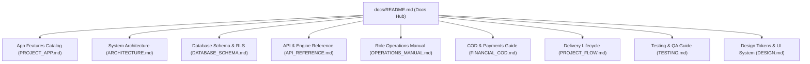

# Oern Delivery Platform Documentation

Welcome to the comprehensive technical and operational documentation for the **Oern Door-to-Door Delivery Platform**.

Oern is a real-time, door-to-door delivery logistics platform designed to coordinate customers, fleet managers, motorcycle and truck drivers, e-commerce sellers, and customer support representatives across a unified, real-time operating workflow.

---

## Documentation Navigation

### Core Specifications & Features

- [**Application Features Catalog (`PROJECT_APP.md`)**](file:///Users/happer/Projects/oern/PROJECT_APP.md)  
  Exhaustive functional breakdown of all screens, interfaces, tools, and capabilities across Customer, Driver, Manager, Seller, and Support workspaces.
- [**System Architecture (`ARCHITECTURE.md`)**](file:///Users/happer/Projects/oern/docs/ARCHITECTURE.md)  
  In-depth architectural breakdown: Next.js 16 App Router, React 19, Supabase PostgreSQL with Realtime WebSockets, Mapbox GL/OSM mapping engine, Multi-Truck VRP Dispatch Optimizer, and AI-powered Road Intelligence.
- [**Database Schema & Security Model (`DATABASE_SCHEMA.md`)**](file:///Users/happer/Projects/oern/docs/DATABASE_SCHEMA.md)  
  Complete Entity-Relationship diagrams, detailed table schemas, constraints, stored procedures (RPCs), and the 5-role Row-Level Security (RLS) permission matrix.
- [**API & Dispatch Engine Reference (`API_REFERENCE.md`)**](file:///Users/happer/Projects/oern/docs/API_REFERENCE.md)  
  REST endpoint specifications (`/api/dispatch/plan`, `/api/road-intel/analyze`), database stored procedures, Mapbox Matrix integration, and external commerce/logistics adapter contracts.

### Operations & User Guides

- [**Role Workspaces & Operations Manual (`OPERATIONS_MANUAL.md`)**](file:///Users/happer/Projects/oern/docs/OPERATIONS_MANUAL.md)  
  End-to-end user manual and operational guide for all 5 platform roles: Customer, Driver/Rider, Dispatch Manager, Merchant Seller, and Customer Support Agent.
- [**Cash on Delivery (COD) & Payment Ecosystem (`FINANCIAL_COD.md`)**](file:///Users/happer/Projects/oern/docs/FINANCIAL_COD.md)  
  Cash liability tracking, Myanmar mobile wallet integration (KBZPay, WavePay, AYA Pay, CB Pay), discrepancy reporting, driver remittance, and manager reconciliation workflows.
- [**Project & Delivery Lifecycle Flow (`PROJECT_FLOW.md`)**](file:///Users/happer/Projects/oern/docs/PROJECT_FLOW.md)  
  Visual order lifecycle diagrams, status transition state machine, job board clustering, and known operational boundaries.

### Quality Assurance & Design System

- [**Testing & Verification Guide (`TESTING.md`)**](file:///Users/happer/Projects/oern/docs/TESTING.md)  
  Test execution guidelines, unit/regression suites (Node 22 native runner), mock Supabase test architecture, Playwright E2E suites, and transactional SQL verification.
- [**Database Assertion & Regression (`DATABASE_TESTING.md`)**](file:///Users/happer/Projects/oern/docs/DATABASE_TESTING.md)  
  Database level assertion patterns and SQL workflow validation.
- [**Design Tokens & System Guidelines (`DESIGN.md`)**](file:///Users/happer/Projects/oern/DESIGN.md)  
  Visual design system, mobile-first responsive guidelines, typography, color palettes, and component design patterns.

---

## Platform Overview at a Glance

| Role | Route Entry | Primary Responsibilities |
| :--- | :--- | :--- |
| **Customer** | `/` (→ `/welcome`), `/home`, `/orders`, `/pickup`, `/track` | Request door pickups, track parcels in real time on interactive maps, view dynamic ETA countdowns, settle COD or digital payments, and access support. |
| **Driver / Rider** | `/rider` (→ `/rider/route`, `/rider/jobs`) | Claim township-clustered job batches, inspect parcel checklists, navigate multi-stop routes, broadcast live GPS, record photo Proof of Delivery (POD), collect COD, and report road hazards. |
| **Manager** | `/manager` (`/home`, `/jobs`, `/vehicles`, `/cod`, `/business`) | Monitor live fleet operations, trigger auto-batching algorithms, assign vehicles and drivers with AI recommendations, manage EV battery and fuel readiness, track flood zones, and reconcile daily COD cash. |
| **Seller** | `/seller` | Register multi-channel commerce shops, submit bulk pickup requests, manually import external carrier shipments, and monitor delivery fulfillment queues. |
| **Support** | `/support` | Universal parcel and tracking search, multi-provider status investigation, case assignment, customer inquiry response, and dispute resolution. |

---

## Core Technologies

- **Runtime & Language:** Next.js 16 (App Router), React 19, TypeScript 5, Bun 1.4+
- **Database & Realtime:** Supabase PostgreSQL with Row Level Security (RLS) and Supabase Realtime WebSocket engine
- **GIS & Mapping:** Mapbox GL v3 with OpenStreetMap (OSM) tile fallback, Mapbox Matrix API, Turf/Haversine spatial calculations
- **Optimization & AI:** Adaptive Large Neighborhood Search (ALNS) Multi-Truck VRP Solver, AI-assisted road intelligence with rule-based fallback
- **Styling & UI:** CSS Variables, Tailwind CSS 4, Material Symbols
